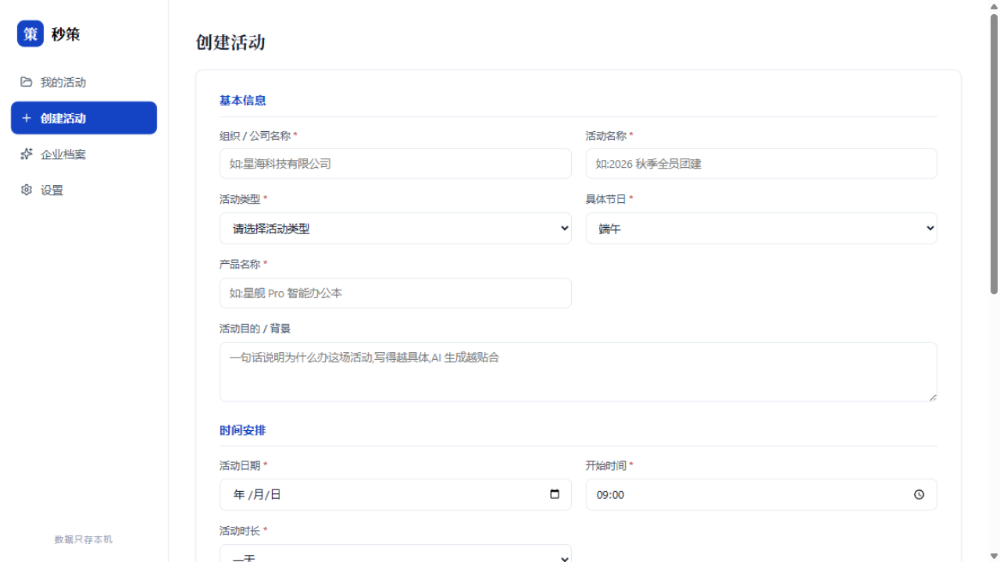
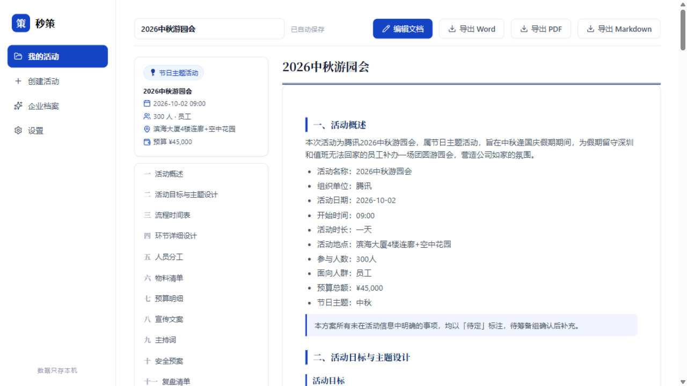
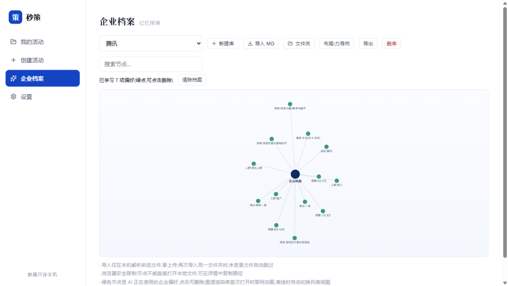

<div align="center">

# Flowvent · 秒策

**面向企业雇主品牌岗位的 AI 原生活动策划工作台**

填一页表单 → AI 深度思考、一次性生成整份策划案 → 所见即所得编辑 + AI 对话改稿 → 记忆库越用越懂你的公司 → 一键导出 Word / PDF / Markdown

     

**[🚀 立即在线使用](https://3091485956-png.github.io/Flowvent/)** · [快速开始](#-快速开始) · [核心能力](#-核心能力) · [记忆机制](#4-记忆库--编译式记忆越用越懂你) · [项目架构](#-项目架构)**

</div>

---

## ✨ 核心能力

### 1. AI 整案生成

一页表单(必填校验 + 条件字段)→ 一次对话产出**完整策划文档**:8~12 个 AI 自拟章节,涵盖概述 / 时间表 / 环节 / 分工 / 物料 / 预算 / 文案 / 主持词 / 安全 / 复盘。

- 未提供的信息诚实写「待定」,绝不编造——这是全产品的口碑底线
- 生成失败表单内容自动保留,一键重试
- 思考强度三档可选(深度 / 均衡 / 快速)
- 「本次不参考我的记忆」开关:随时要一份不带任何历史偏好的干净稿

### 2. AI 深度思考流

生成不再是假进度动画:SSE 流式逐 token 上屏,模型的 `reasoning_content` 实时滚动显示在深色终端风思考面板;阶段进度由**真实事件驱动**(请求发出 = 理解中 → 首个思考 token = 规划中 → 首个正文 token = 撰写中),秒表只报真实耗时。接口不认参数时自动去参重试,非流式网关自动回落。

### 3. AI 对话编辑

Word 式文档编辑(独立标签页):整篇连续文档直接改文字,章节标题固定防误删。

- **AI 编辑对话面板**:自然语言下指令("把流程整体提前半小时"),AI 直接改写对应章节,动作卡一键撤销
- **选区 AI 对话框**:选中文字右键,AI 润色 / 扩写 / 重写前先弹小框——你可以顺口说一句"以后这段都不要提钱",这句话会连同修改一起进入记忆
- 对话历史进入记忆管道,长期偏好可「设为默认」

### 4. 记忆库 · 编译式记忆,越用越懂你

V1.1 依据 [LLM-Wiki](https://github.com/nashsu/llm_wiki) 范式重构为**编译式知识库**——知识一次编译、持续维护,而非每次注入重新推导;V1.2 参考 Claude Code 记忆机制补全"验证与修订"两环:

```
看(捕获事件) → 记(编译成页面) → 用(注入生成) → 核实(导出认可) → 改口(精灵修订)
```

- **来源分层**:亲口确认 > 反复强调 > 改稿方式 > 导入文档(过往方案 .docx / 公司制度 / MD 笔记)> 导出行为——不同来源不同信任度
- **增量编译**:AI 两步推理(先分析矛盾、再产出页面补丁),无 AI 时本地确定性编译兜底;水位线增量,失败自动重试
- **两级注入**:确认级(生成时严格遵守)与归纳级(仅供参考);按与当前活动的**相关性**选页,归纳级记忆自带"观察时间 / 可能过时"标注
- **接受信号**:导出即认可——AI 写完后一字未改的章节为记忆投票,确认页累积「被导出认可」次数;偏好可带「为什么」(Why),让 AI 有分寸感
- **洞察页**:记忆矛盾、过时 / 孤页 / 重复检查、图谱洞察(枢纽页 / 跨模块桥梁 / 缺口)、编译记录,集中一个页面由你裁决
- **记忆精灵**:一句话管记忆——「把致辞改成 15 分钟」「旧场地不要了」,AI 给出修改卡片,**点「应用」才生效**,删除有 tombstone 永不复活
- **图谱可视化**:节点按模块着色(公司 / 各部门 / 风格 / 其他),悬停高亮关联邻域;页面详情可溯源到事件;Obsidian 兼容 Markdown 导出
- 档案是用户数据:可查看、可对话修改、可一键清除,**只存本机**

### 5. 同源三导出

- **Word(.docx)**:零依赖纯前端生成,朴素黑白公文样式——黑色标题、细黑表格线、合计行加粗
- **PDF**:所见即所得,块感知分页,与网页预览完全一致
- **Markdown**:单文件,结构无损

三者由同一份 sections 数据渲染,结构天然一致。

## 🖼️ 界面预览

| 欢迎首页 | 创建表单 |
| :---: | :---: |
|  |  |

| 方案生成结果 | 记忆库图谱 |
| :---: | :---: |
|  |  |

## 🚀 快速开始

**方式一(推荐):** 直接双击 `app/index.html` 即可在浏览器中使用——纯前端、零依赖、零构建,已有方案的查看 / 编辑 / 导出全程离线可用。

**方式二(本地服务器):**

```bash
cd app
node .serve.js 8137        # 或任意静态服务器
# 打开 http://localhost:8137
```

> 首次生成方案前,请先在「设置」配置任意 OpenAI 兼容 AI 接口(智谱 / 通义 / DeepSeek / OpenAI / Ollama 私有网关均可)。**API Key 仅存本机浏览器 localStorage,不上传任何服务器。**

## 🗺️ 版本历程

| 版本 | 主题 | 关键词 |
| --- | --- | --- |
| V1.0 | AI 唯一生成源 | 整案生成 / 深度思考流 / 对话编辑 / 记忆档案 / 同源三导出 |
| V1.1 | 记忆库 Wiki 化 | [LLM-Wiki](https://github.com/nashsu/llm_wiki) 范式:事件层 → 编译页面 → 两级注入;洞察页 / 图谱着色 / Obsidian 导出 |
| V1.2 | 记忆来源与验证 | 接受信号(导出认可)/ 偏好带 Why / 记忆精灵 / 导入分类型 / 笔记并入编译 / 保质期标注 / 朴素 Word |

## 🧱 项目架构

**总体形态**:零后端、零构建、零外部请求(除用户自配 AI 接口)的 vanilla JS 单页应用。所有模块挂载于 `window.EP` 命名空间,16 个经典 `<script>` 顺序加载;数据与 AI Key 仅存 localStorage,`file://` 双击即用;编辑页走 hash 路由 `#edit=<planId>`。

### 模块清单(`app/assets/js/`)

| 模块 | 职责 |
| --- | --- |
| `bg.js` | Aurora 动态背景(ogl 1.0 移植,canvas rAF) |
| `icons.js` | 内嵌图标体系:Lucide 26 + IconPark 8,全部 SVG 内嵌、离线零请求 |
| `md.js` | 极简 Markdown 渲染器(服务文档预览/编辑往返) |
| `struct.js` | 文档结构契约层:类型表 / `parseDoc` AI 输出容错解析 / 旧数据迁移 / `metaRows` 单一事实源 |
| `profile.js` | 事件原始层(Raw Sources):record 单一入口 → 计数档案 + rawLog(seq / 截断 / 环形缓冲) |
| `wiki.js` | 编译式记忆库:页面模型 / 增量编译(AI 两步 + 本地兜底)/ 相关性注入 / lint / 洞察 / 精灵动作 / tombstone |
| `ai.js` | AI 层:整案流式生成 / 章节重写 / 选区意图修改 / 对话编辑 / 记忆编译与精灵(严格 JSON 契约)/ SSE 解析 |
| `storage.js` | localStorage 持久化 + 旧结构自动迁移 |
| `memory.js` | 记忆库图谱数据层(`cat` 分类契约;已编译页面优先呈现) |
| `intake.js` | 文件导入:.docx 内嵌 ZIP 解压 + XML 解析 + PDF 文本提取 |
| `memoryview.js` | 记忆库面板:图谱/洞察双视图 + 编译记忆 + 记忆精灵对话 |
| `exporter.js` | Markdown 导出 + 打印组装 |
| `word.js` | 真 .docx 生成器:CRC32 + STORE ZIP + 最小 OOXML,朴素黑白样式,零第三方库 |
| `pdf.js` | 所见即所得 PDF:jsPDF + html2canvas 块感知分页(已本地化打包) |
| `doceditor.js` | 文档编辑标签页:WYSIWYG + 选区 AI 对话框 + AI 对话面板 + 自动保存 |
| `app.js` | 总装配:视图路由 / 创建流程 / 面板与弹窗 / 生成管线 |

### 关键设计决策

- **AI 是唯一生成来源**:不内置任何内容模板。prompt 契约约束输出为「## 章节」式 Markdown(禁 `#`/`###`,时间表/分工/物料/预算必须表格,未给信息写「待定」不编造);`struct.parseDoc` 做容错解析。
- **思考流真实驱动**:阶段切换绑定真实 token 事件,非流式网关诚实降级,不假装思考;30 秒无 token 判死、总上限 4 分钟。
- **记忆铁律(历次裁定汇总)**:记忆只影响风格与背景事实,永不改变「待定不编造」契约;活动信息永远赢过记忆;具体日期/地点/人数/预算是单次方案信息,**不进记忆**;venue/budget/department 只收集不注入;注入摘要限长;AI 不经用户确认绝不改记忆。
- **记忆编译式架构**:rawLog 事件层 → 增量编译为互链页面(AI 两步推理,本地确定性兜底)→ 按相关性 × 两级 × 置信度组装注入;tombstone 保证删除不复活;wiki 为空时逐字节回退统计注入(零回归)。
- **接受优先于推测**:导出统计(kept/edited)、选区意图原话、偏好 Why——用户"用脚投的票"权重高于行为推断;机器只加分不扣分,推翻裁决永远留给人。
- **编辑往返**:contenteditable → `htmlToMd` 逆变换写回,浏览器撤销栈完整保留;章节标题固定防误删。

## 📁 目录结构

```
Flowvent/
├── README.md                     ← 本文件
├── 交接文档.md                    ← v2 系统性审查报告(四维框架)与交接基线
├── 体验报告-秒策全真模拟.md        ← 第一轮全真模拟体验报告
├── 体验报告-秒策全真模拟第二轮.md  ← 第二轮体验报告(50 份方案 × 三评审智能体)
├── docs/                         ← 全过程文档(01~19 + backlog)
├── app/                          ← 产品本体(纯前端静态应用)
│   ├── index.html
│   ├── .serve.js                      临时静态服务器(本地测试用)
│   └── assets/
│       ├── styles.css                 设计令牌 + 三视图 + 打印样式
│       └── js/                        16 个模块(见上表)
├── test/
│   └── run.js                    零依赖测试基线(node test/run.js,107 断言)
├── tools/
│   ├── gen-icons.js              图标资产生成器(CDN 拉取 + 品牌双色注入)
│   └── gen-aurora.js             Aurora 背景资产生成器
└── 体验测试/                      全真模拟的证据截图与产物
    ├── evidence/                      6 张关键界面截图
    ├── plans-100.md · probe-results.jsonl
    └── 第二轮/                       29 份 AI 生成方案样本
```

## 📚 文档导航(`docs/`)

| # | 文档 | 内容 |
| --- | --- | --- |
| 01 | 问卷与需求澄清 | 目标用户 / 场景 / 痛点 |
| 02 | brief | 项目一句话定位(含提示词优化记录) |
| 03 | 竞品分析 | 竞品格局与差异化 |
| 04 | 用户声音 | 用户原声与诉求归纳 |
| 05 | 需求分层 | MoSCoW + 验收标准 |
| 06 | 产品框架 | 信息架构与核心闭环 |
| 07 | 技术框架 | 技术选型与模块划分 |
| 08 | 交付验收 | 验收对照表 + 三轮缺陷修复记录 |
| 09 | 个性化与记忆方案 | 「越用越懂用户」初版方案 |
| 10 | 无声助理改造方案 | 被动捕获 / 不加交互负担的原则 |
| 11 | AI 整案生成重构 | v2 重构:删模板、AI 唯一生成源、决策依据 |
| 12 | 越用越懂用户·框架设计 | 五事件捕获 → 档案 → 注入的完整链路 |
| 13 | Memory 记忆库方案 | 图谱数据模型与可审计性 |
| 14 | 品味学习方向 | 从历史方案 .docx 学习风格的方案 |
| 15 | 深度思考 / AI 对话编辑 / 记忆库四模块 | 第三轮大改框架与实现记录 |
| 16 | 记忆库 Wiki 化重构 | V1.1:LLM-Wiki 范式(Raw / 页面 / Schema 三层 + Ingest / Query / Lint) |
| 17 | 记忆来源与运作机制讨论稿 | 五主张 / 来源分层 / Claude Code 源码对照 |
| 18 | 记忆机制 V1.2 工程计划 | F1~F11 三批实施记录 |
| 19 | 记忆机制产品决策 | 该做什么 / 不该做什么 / 为什么 |
| — | backlog | 范围守卫:新想法先落这里 |

## 🧪 测试

```bash
node test/run.js    # 107 断言全绿,零依赖
```

覆盖:结构契约解析 / 存储与迁移 / docx 生成(朴素样式断言,另经 `unzip -t` + XML 良构验证)/ SSE 思考流解析 / 对话编辑与精灵 JSON 容错 / rawLog 原始层 / 记忆页面编译·相关性注入·tombstone·lint·洞察 / 接受信号回流 / 偏好 Why / 导入分类型 / 免记忆开关零回归。关键交互另经本地服务器 + 桩 fetch 的浏览器 E2E 全链验证。

## 🔒 隐私与数据

- 数据与 AI Key **均只存本机 localStorage**,零后端、零上传、零埋点
- 记忆档案是用户数据:可查看、可对话修改、可一键清除
- 清空浏览器数据会丢失方案——请及时导出 .docx / Markdown 归档

## ⚠️ 已知限制

- 生成 / 重新生成 / 对话编辑 / 记忆编译需配置 AI 接口;未配置时引导前往设置,已有方案的查看 / 编辑 / 导出与本地确定性记忆不受影响
- .docx 中的列表为字面项目符号(非 Word 原生自动编号),如需编号列表可在 Word 中一键转换
- 跨标签页同时编辑同一方案为整方案级最后写入优先(已知 backlog 项)
- 记忆格式偏好自定义(如自定义 Word 样式)规划于后续版本

## 📄 许可与致谢

- 功能图标 [Lucide](https://lucide.dev)(ISC 许可)· 类型标识 [IconPark](https://iconpark.oceanengine.com)(MIT 许可)
- 编辑体验参考 Ranuts Document 的产品形态,按本产品轻量本地架构等效实现,未引入其代码
- PDF 导出内置 [jsPDF](https://github.com/parallax/jsPDF) + [html2canvas](https://github.com/niklasvh/html2canvas),已本地化打包、离线可用
- 记忆架构借鉴 [LLM-Wiki](https://github.com/nashsu/llm_wiki) 设计思想与 Claude Code 记忆机制的工程经验,零代码复制

---

<div align="center">

## 🌐 快捷访问入口

### [🚀 立即在线使用 Flowvent](https://3091485956-png.github.io/Flowvent/)

**https://3091485956-png.github.io/Flowvent/**

在线版与本地版完全同源,由 GitHub Pages 自动部署 `app/` 目录 · 首次生成前请先在「设置」中配置 AI 接口

也可以随时本地使用:双击仓库中的 `app/index.html` 即可

</div>
